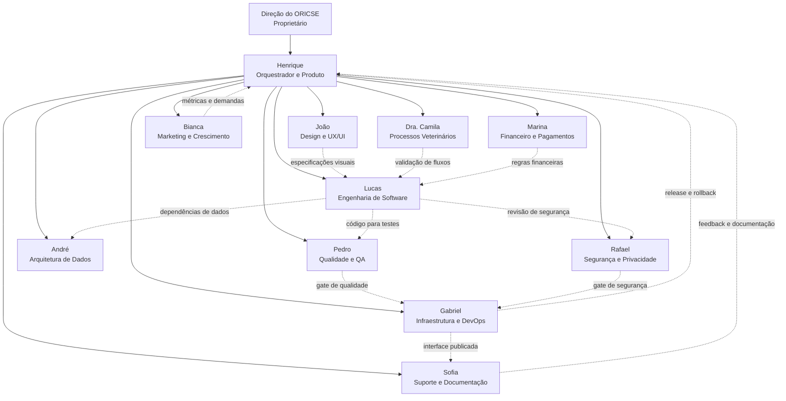

# Organograma da equipe ORICSE

## Hierarquia

1. **Direção do ORICSE** — define estratégia, prioridades e aprovações de alto risco.
2. **Henrique** — transforma objetivos em tarefas, coordena especialistas, resolve dependências e consolida releases.
3. **Especialistas** — executam suas áreas com autonomia dentro das permissões e limites definidos.

## Núcleos de trabalho

| Núcleo | Agentes | Resultado principal |
|---|---|---|
| Produto e experiência | Henrique, João, Dra. Camila, Sofia | Requisitos, interface, fluxos e documentação |
| Engenharia e dados | Lucas, André | Código, APIs, banco e integrações |
| Confiabilidade | Rafael, Pedro, Gabriel | Segurança, testes, deploy e recuperação |
| Negócio e crescimento | Marina, Bianca | Pagamentos, receita, marketing e aquisição |

## Fluxo padrão

Direção solicita → Henrique distribui → especialistas executam → Pedro testa → Rafael verifica segurança → Gabriel publica ou reverte → Henrique reporta o resultado.

Henrique pode interromper tarefas conflitantes. Rafael pode bloquear uma entrega insegura. Operações irreversíveis, financeiras críticas, clínicas ou de exposição de dados exigem aprovação da Direção.

